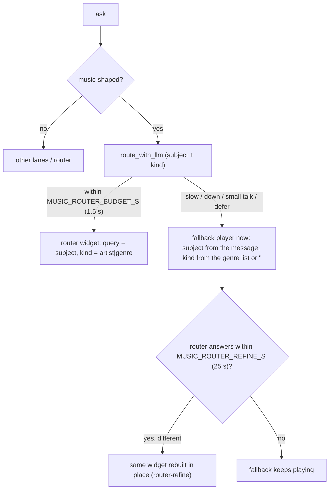

# Execution pipeline

One chat turn runs through five ordered stages. Every stage has a deterministic
fallback, so a missing model degrades the answer instead of emptying the canvas.

## Stage 0 — Ingest

`POST /session/message` (`app/routes/message.py`) receives the user message and the
session id. The route opens the SSE response, records the user message in
`chat_messages`, and loads the session context (recent turns, the current canvas,
the active note). The route is the only writer of the chat transcript.

## Stage 1 — Classify and route

The fast lane inspects the message before any model call:

- A **music-shaped** ask (a play verb plus a subject, or a medium word) sets
  `music_fallback` and skips the list/notes/compose/answer/build lanes.
- A **news** ask goes through `classify_news_ask`, which recognises topic asks and
  named live networks.
- Video/live asks keep their deterministic override; the router does not get to
  turn "cnn live news" into a news card.
- Everything else reaches the LLM router, which returns a path plus modifiers
  (including `modifiers.kind` for music).

The router catalog uses placeholder examples only. Real names in the catalog make
the model copy an example into the query (the "heavy metal music → buckethead"
failure). `music_query_grounded` then rejects a router subject that shares no word
stem with the message, so a typo fix such as "coletrain" → "John Coltrane" survives
while an invented subject does not.

## Stage 2 — Agent and tools

The selected path calls the shared runtime through `app/adapters/runtime/`:
`/agent` for a chat turn, `/models` and `/health` for admission and health. The
agent may call the runtime's tools (news search, scraper, embedding); HTML-Notes
does not execute arbitrary agent HTML. The runtime answer is parsed into a widget
plan: a widget type plus its data fields.

## Stage 3 — Research and evidence

When the ask needs current facts, the research coordinator
(`app/services/research/coordinator.py`) dispatches workers from
`app/services/research/workers/` (news, price, peer/sector, primary source,
skeptic). Evidence lands in `research_evidence` with its source, and the
synthesizer writes an answer version. The budget module caps the number of worker
calls and the wall time; a capped run returns the evidence it has instead of
failing.

## Stage 4 — Render

`app/widgets/factory.py` renders the chosen widget from server-side templates.
The factory stamps the widget's config as strict JSON in `data-hn-config` next to
the Alpine state, so the client can rebuild the same widget later without guessing
defaults. The SSE stream emits the widget frame, then the assistant message.

## Stage 5 — Persist and repair

`app/canvas_manager.py` places the widget on the canvas and serializes the canvas
into the note row. The client (`app/static/js/widgets.js` and
`app/static/index.js`) mounts the widget, wires resize and messages, and runs the
self-heal path:

- `musicWidgetNeedsRebuild` rebuilds only when the Alpine wiring is missing or in
  the old positional form, and rebuilds from `data-hn-config`.
- The clock self-heal keeps the server's `clockWidget(tz, …)` call instead of
  forcing `'local'`.
- `WidgetResizer` skips device-style widgets (`.youtube-player`, the Walkman card)
  and derives their height from their width.

## Music fast lane, in detail

Knobs live in `app/config.py`: `MUSIC_ROUTER_BUDGET_S` (default 1.5) and
`MUSIC_ROUTER_REFINE_S` (default 25). The builder trusts the router's query (it
does not re-strip the raw message), and the old `"lofi"` default is gone; an empty
kind means the music service's own default mix.

## Turn termination

A turn always ends with one of: a rendered widget plus message, a text answer, or
an error card. The assistant message is written even when rendering fails, so the
session history and the routing eval remain complete.
