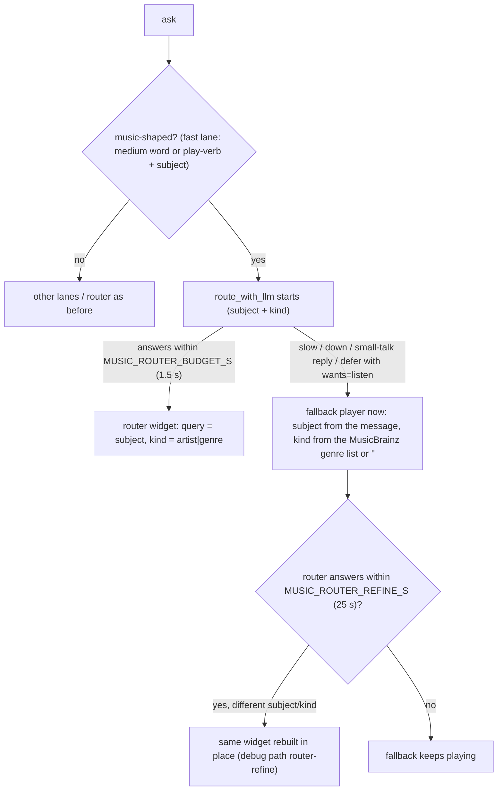

# Music asks: the LLM understands them, no regex guesses (2026-11-03)

## The tickets

| # | Symptom (owner's console, 2026-11-03) | Root cause | Status |
|---|---|---|---|
| 1 | "buckethead instrumentals" played Duke Ellington: the widget logged `Init. term="jazz"` | `index.js` self-heal treated every music widget as broken (it looked for a `.material-symbols-outlined` play button that the walkman card, `038f8a6`, no longer has), then rebuilt it with a hardcoded `genre = 'jazz'` | fixed |
| 2 | "buckethead instrumental music" started a GENRE mix | the music fast lane in `routes/message.py` built the widget itself with `kind: "genre"` hardcoded for any ask containing "music"; the router never saw it. 21 of the 52 music asks in the eval set are `<artist> music` | fixed |
| 3 | `POST :8002/api/music/history` → 422 on every track | `widgets.js` sent `{track_path, is_youtube, youtube_id, …}`; music-player's `PlayEvent` requires `id, track_id, timestamp, duration, completion_rate, source, context` | fixed |
| 4 | server play history never showed in the widget | `fetchHistory()` read `res.history`; `/history/recent` returns a bare list | fixed |
| 5 | `favicon.ico` 404 | no route | fixed |
| 6 | Tailwind CDN warning | `index.html` loads `cdn.tailwindcss.com` | open: moving to a Tailwind build is a separate change; the warning is harmless |
| 7 | Router answers slowly when the shared local boxes are busy | Jetson `nemotron35` and Gold Spark DeepSeek also serve other agents; measured 30 s for a 20-token reply at 11:33, 0.46 s at 11:37 | handled by the music budget + refine below; the box load itself is outside this repo |

## How a music ask is handled now

- **One config, owned by the server.** `render_mini_music_player` stamps `data-hn-config` (strict JSON) next to `x-data`. The self-heal (`musicWidgetNeedsRebuild` / `recoverMusicWidgetConfig` in `app/static/index.js`) rebuilds only when the Alpine wiring is missing or in the old positional form, and rebuilds from that config, never from a default genre. The clock self-heal keeps the server's `clockWidget(tz, …)` call instead of forcing `'local'`.
- **Detected by the fast lane, understood by the router.** The lane sets `music_fallback` and skips the list/notes/compose/answer/build lanes. The router catalog makes `modifiers.kind` required and uses only placeholder examples: with real names in it, the model copied "buckethead" into the query for "heavy metal music".
- **Grounding.** `music_query_grounded` throws away a router subject that shares no word stem with the message; typo fixes ("coletrain" → "John Coltrane") keep a shared word.
- **The builder trusts the router's query** (no re-stripping the raw message) and the `"lofi"` default is gone; empty means the music service's own default mix.
- **Missing kind → fact check.** `resolve_music_kind` answers `"genre"` only for an exact MusicBrainz genre (`app/domain/musicbrainz_genres.txt`, CC0, 2,220 names), else `""`. A "last word is a genre" rule was dropped because "instrumental" is a listed genre.
- **Router debug frame** carries `modifiers`; a late answer emits `{"path": "router-refine", "config": {genre, kind}}`.
- **History** posts the `PlayEvent` shape (`buildPlayEvent`; `track_id` = `youtube://<id>`, as the music-player web app records it) and maps `/recent` rows (`mapServerHistory`).
- Knobs: `MUSIC_ROUTER_BUDGET_S` (default 1.5), `MUSIC_ROUTER_REFINE_S` (default 25), both env vars in `app/config.py`.

## Evidence

Eval set: `tests/routing_eval.json`, 87 real asks mined from the deployed `chat_messages` (2,966 user rows, 1,450 distinct), labelled with type / kind / subject. Tool: `scripts/routing_eval.py` (`--mode router` = the model alone, `--mode system` = the real `/session/message` in-process with the live router). Kind `""` counts as right for a genre ask, because the widget treats it as genre-first.

| Run (2026-11-03) | Music asks correct | First player |
|---|---|---|
| main before the change | 31/52 (59.6%) | p50 0.06 s |
| branch, router blocking with a 4 s budget, no refine | 19/52 under box load (48 of 52 asks hit the budget) | p50 4.07 s |
| branch, 1.5 s budget, no refine | 31/52 (50 of 52 hit the budget) | p50 1.57 s |
| **branch as shipped: 1.5 s budget + refine** | **48/52 (92.3%)** | p50 1.58 s, refined in place when the router answers |
| router alone, final catalog | 40/52; 5 of the 12 misses were vLLM ReadTimeouts and 4 were "play music" answered with a chat reply (now handled) | p50 3.2 s, p95 23.3 s |

The four misses left: "four tet music" and "gwar music" (the router never answered within 25 s; the fallback played them genre-first), "jungle house music" (router shortened it to "jungle"), and "metal music from the 80s … like iron maiden" (router chose the artist Iron Maiden; arguably right).

**Decisions taken from the evidence**

- DECISION: only the music lane moved to the router. On video the router scored 11/17 and turned "cnn live news" / "bloomberg live news" into a news card, the exact failure the deterministic video/live override exists for; news (10/12) already runs through `classify_news_ask`. Those lanes stay until the router beats them on this eval set.
- DECISION: show the fallback player, then refine it. The blocking variants above either added 4 s for nothing or gained nothing, because the shared boxes were saturated.
- DECISION: no live MusicBrainz artist lookup. Measured 0.6-9.3 s per call and noisy (`smooth jazz` → artist "Smooth Jazz Band" at score 100).
- DECISION: no `subject_type` / `confidence` fields in the router output; `modifiers.kind` is the only consumer, and extra output tokens cost latency on every route.

## Tests

- `tests/test_music_config_and_history.py`: real factory HTML → real `index.js` helpers in node; the widget's play event validated against music-player's real `PlayEvent` model (with a red witness that the old body fails it); twin-iframe parity.
- `tests/test_music_routing_understanding.py`: the full `/session/message` chain with only the model faked: the router sees music asks; fallbacks for router-down, small talk, defer-with-listen and a slow router; refine-in-place; grounding; verbatim query; kind resolution. Red on main 7/7 before the change.
- Stale tests rewritten (they grepped for the pre-walkman template and had been red on main since `038f8a6`): `test_music_genre_routing.mjs`, `test_music_handoff.mjs`, `test_ghost_audio_and_history.mjs`. The node harness gained `window.addEventListener` and an unref'd `setInterval`, which un-broke 12 behaviour tests that had been failing on main (node: main 93/108 → 106/106).
- False positive recorded: `test_ghost_audio_and_history.mjs` only checked that the string `/api/music/history` exists, so it stayed green through ticket 3.
